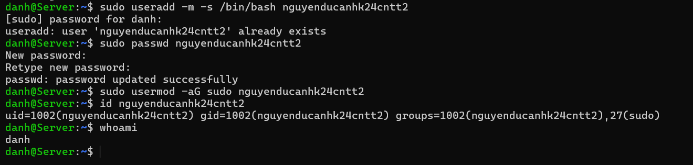
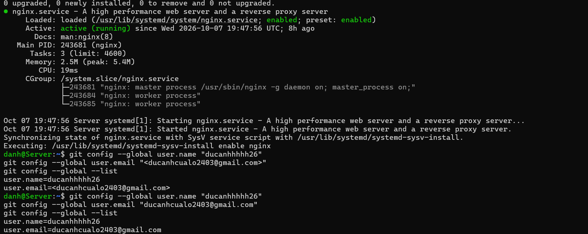

01 - user
danh@Server:~$ sudo useradd -m -s /bin/bash nguyenducanhk24cntt2
[sudo] password for danh:
useradd: user 'nguyenducanhk24cntt2' already exists
danh@Server:~$ sudo passwd nguyenducanhk24cntt2
New password:
Retype new password:
passwd: password updated successfully
danh@Server:~$ sudo usermod -aG sudo nguyenducanhk24cntt2
danh@Server:~$ id nguyenducanhk24cntt2
uid=1002(nguyenducanhk24cntt2) gid=1002(nguyenducanhk24cntt2) groups=1002(nguyenducanhk24cntt2),27(sudo)
danh@Server:~$

**trạng thái Nginx và Git config**

